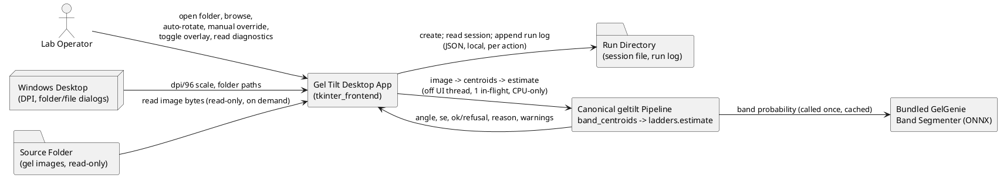
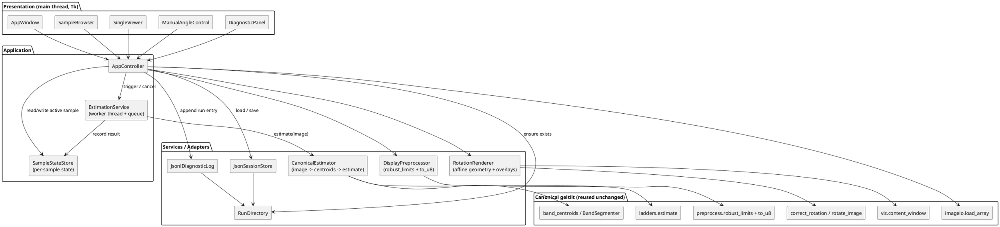
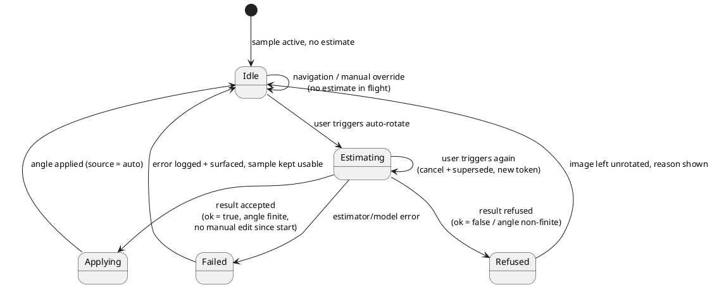
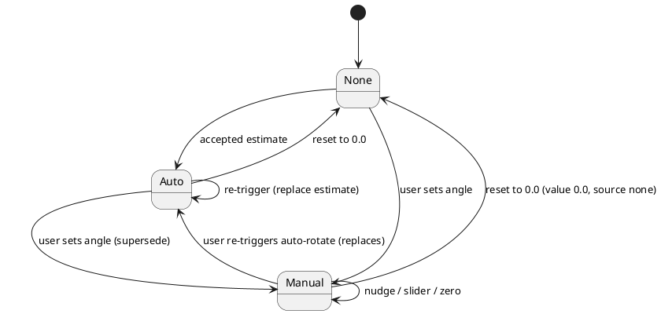
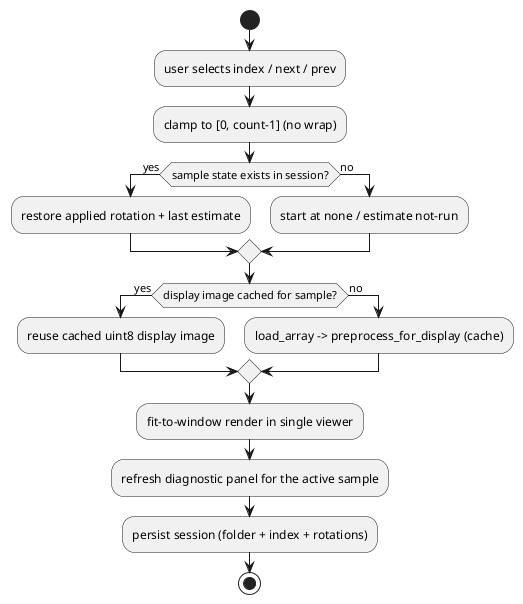
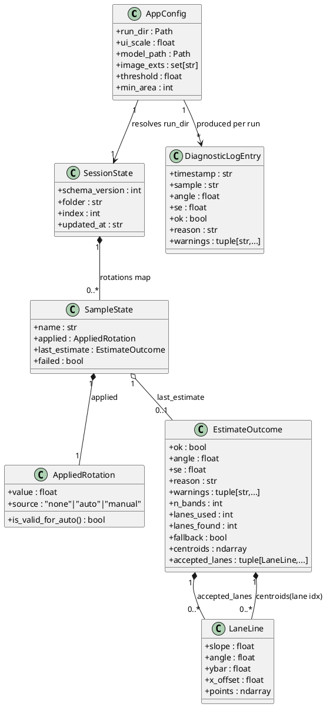

# tkinter_frontend — Technical Design

> Feature: `tkinter_frontend` · Source of truth: `.codeartsdoer/specs/tkinter_frontend/spec.md`
> This document translates the **WHAT** in `spec.md` into the **HOW** of a new unified
> single-window Tkinter desktop application. It reuses the canonical in-repo pipeline
> (`band_centroids` → `ladders.estimate`) and the canonical display preprocessing
> (`robust_limits` + `to_u8`) unchanged, and it introduces **no** parallel rotation engine.

---

# 1. Analysis of Relationships Between Requirements and Existing Features

The App is a thin desktop presentation layer over a mature, in-repo processing core. Nearly all of
the algorithmic work required by `spec.md` already exists; what is genuinely new is the *windowed
application* that orchestrates it: a single-window shell, an asynchronous estimation service, a
per-sample session model, a diagnostic log, and the manual-override / overlay presentation. This
section establishes exactly which requirements are already implemented, which need extension, and
which must be built from scratch.

## 1.1 Comparison of Requirement Features and Existing Features

### 1.1.1 Implemented Features

| Requirement Feature | Existing Feature | Code Location | Match Level |
|---------|---------|---------|--------|
| Load supported raster images, preserving native dtype (8/16-bit int, float) and channels (spec §4.5.4, §6.1) | `load_array` (PIL open, `I;16`/`I` dtype normalisation) and `to_gray` (float32 conversion) | `geltilt/imageio.py:29`, `geltilt/imageio.py:14` | 100% |
| Canonical display preprocessing: robust percentile limits then uint8 mapping with gamma fixed at 1.0 (spec §1.4, §4.5.5) | `preprocess_for_display` = `robust_limits(0.5, 99.5)` + `to_u8(…, 1.0)` | `geltilt/labeler.py:50` → `geltilt/preprocess.py:15,25` | 100% |
| Supported-extension filter, case-insensitive, ordered by ascending file name (spec §5.1.1 rules 1/2/5, §6.1) | `find_images` (`IMAGE_EXTS`, sorted by lower-cased name) | `geltilt/labeler.py:124` | 100% |
| Band centroid extraction from an image via the bundled GelGenie ONNX segmenter, cached per process (spec §1.2.4, §3.2.4, §5.2.1) | `band_centroids` + cached `default_segmenter` + `BandSegmenter.probability` | `geltilt/banddetect.py:19,50` → `geltilt/bandmask.py:77,90` | 100% |
| Single canonical lane-based tilt estimate with full diagnostics — angle, se, ok/refusal, reason, warnings, band count, lanes used/found (spec §5.2.1, §6.2) | `ladders.estimate` result dict (`angle`, `se`, `ok`, `ladders`, `n_ladders`, `kept`, `n_bands`, `fallback`, `overdispersion`, `reason`, `warnings`, …) | `geltilt/ladders.py:685,704` | 100% |
| One-call canonical pipeline: image → band centroids → lane estimate; refusal leaves image unrotated (spec §1.4.1, §5.2.2) | `estimate_rotation_ladders` | `geltilt/core.py:232` | 100% |
| Rotation application in the estimator's own sign convention (positive = CCW, applied as-is, never negated), dtype/size preserved (spec §2, §5.2.6, §5.5.4) | `correct_rotation` → `rotate_image` (`cv2.getRotationMatrix2D`, `INTER_LINEAR`) | `geltilt/core.py:196` → `geltilt/rotation.py:36` | 100% |
| Per-monitor DPI awareness and Tk pixel-per-point scaling (spec §4.5.2) | `enable_dpi_awareness`, `dpi_scale`, `apply_tk_scaling` | `geltilt/labeler.py:144,172,193` | 100% |
| Fit image to viewer preserving aspect ratio, cropping to content window (spec §5.5.2) | `content_window` | `geltilt/viz.py:33` | 100% |
| Rotate/zoom/pan display geometry about the pointer (spec §5.5.3) | `render_display`, `affine_coeffs`, `source_to_screen`, `screen_to_source` | `geltilt/labeler.py:110,97,71,86` | 100% |
| Run-directory resolution: frozen build → executable folder, source → CWD (spec §5.6.1) | `run_directory` | `geltilt/labeler.py:133` | 100% |
| Windowed (no-console) PyInstaller packaging, single-file, bundling `geltilt`/`cv2` submodules (spec §4.5.1) | `build_exe.py`, `build_projview_exe.py`, `run_projview.py`, `geltilt-projview.spec` | repo root | 75% |
| Result-record fields required for CLI parity — angle, se, ok, reason, warnings, kept/n_ladders, n_bands, fallback (spec §4.4.2) | `cli._process_one` record construction | `geltilt/cli.py:59` | 75% |

### 1.1.2 Features Requiring Extension

| Requirement Feature | Existing Feature | Difference Description | Extension Direction |
|---------|---------|---------|---------|
| Per-sample session persistence of the applied rotation value + source, plus last folder/index (spec §5.6.2, §6.3, §6.4) | Labeler session (`_load_session`/`_save_session`) | Stored payload is only `{folder, index, labels-file-name}`; there is no mapping of sample name → `{value, source}`, and no "none/auto" provenance | Define a new session schema and JSON round-trip; reuse the `run_directory()` + `json` + tolerant-read pattern. Keep exactly one session file in the run directory. |
| Append-only structured diagnostic log per auto-rotation run (spec §5.6.4, §4.4.1) | None | No diagnostic log exists anywhere in the repo | Add a `DiagnosticLog` writer that appends one JSON line per run (timestamp, sample, angle, se, ok, reason, warnings) into the run directory. |
| Accepted-lane subset for the overlay (spec §5.4.4, §6.2.9/10) | `ladders.estimate` returns **all** detected lanes (`ladders`) and only a `kept` **count** | The accepted (`pooled`) subset is not exposed, so the overlay cannot draw "accepted lane lines" without re-deriving the agreement rule | **Additive** output on `ladders.estimate` (`kept_lanes` containing the pooled lane dicts, each with `s`, `ybar`, `idx`). No scoring/selection logic changes, so determinism and CLI parity are preserved. |
| Band centroids available for the overlay from the same canonical run (spec §5.4.4) | `estimate_rotation_ladders` returns only the estimate dict; the `(N,2)` centroid array is discarded | The App needs both the centroids and the estimate from one run | Thin adapter wrapping the *same two canonical calls* (`band_centroids` → `ladders.estimate`) that returns `(centroids, estimate)`. Not a new engine — the identical functions, invoked together. |
| Large folders (≥2000 samples) stay responsive (spec §5.1.3.4) | `find_images` builds one eager sorted list | Populating a `Listbox` with thousands of rows can stall the UI thread | Keep `find_images` for listing; populate the browser lazily/virtualised (windowed slice), preserving the stable ascending-name index. |
| On-viewer overlay of band centroids, accepted lane lines, and optional vertical guides (spec §5.4.4, §5.5.5) | Labeler draws only fixed vertical guides (`_render`) | No mechanism to draw per-sample vectors/lines over the composited image | New overlay renderer that draws centroids/lane lines/guides onto the rendered view (canvas items or a composited PIL layer), toggled by the user. |
| Off-UI-thread estimate with a busy indicator; window not blocked > 250 ms (spec §4.1.3, §5.2.2) | CLI and labeler estimate synchronously on the calling thread | No worker thread, no queue, no busy state | New `EstimationService` (worker thread + `queue.Queue` + Tk `after` polling). Must **serialise** calls because `ladders.P` is module-global. |
| DPI scaling applied to the new window geometry, fonts, and hit targets at 192 DPI (spec §4.5.2, §5.4.6) | DPI helpers exist but only feed the legacy labeler/projview layout | New layout must be sized with `dpi/96` for fonts, paddings, row heights, control sizes, and guide spacing | Consume the existing `dpi_scale()`/`apply_tk_scaling()` and derive a single `ui_scale` used throughout the new layout. |
| Packaging entry point for the new unified app (spec §4.5.1) | `build_exe.py` / `build_projview_exe.py` target legacy tools | Need a new entry script, a new `.spec`, and bundling of the ONNX model path | New `run_app.py` + `build_app_exe.py` + `geltilt-app.spec`, modelled on the existing windowed build pattern; bundle/collect `geltilt` and `cv2` submodules. |

### 1.1.3 Features or Interfaces Requiring New Development

Grouped by business module. Each point states its inputs, outputs, core logic, and cross-module
dependencies. No corresponding implementation exists in the repository.

**A. Application shell and single-window layout**
- *Inputs*: launch parameters (optional initial folder, optional run-directory path); DPI scale.
- *Outputs*: one `tk.Tk` root window containing exactly one viewer surface, one sample browser, one
  control strip, one diagnostic panel. No second image surface.
- *Core logic*: build the window; apply `ui_scale = dpi/96` to all geometry/fonts; wire the
  controller; create/point at the run directory; restore the previous session.
- *Depends on*: DPI helpers, `SessionStore`, `RunDirectory`, viewer, browser, diagnostic panel.

**B. Sample browser and index navigation**
- *Inputs*: folder path; user keys/selection; large-folder list.
- *Outputs*: ordered sample list, active index, previous/next/jump actions; displayed index and name.
- *Core logic*: list supported images ascending by name, assign stable index from 0, clamp at the
  ends (no wrap), lazily populate the list control, keep exactly one active sample.
- *Depends on*: `find_images`, per-sample state store.

**C. Asynchronous estimation service**
- *Inputs*: active sample path; trigger/cancel; request token.
- *Outputs*: estimate diagnostics; accepted angle or refusal; error; busy/Idle transitions.
- *Core logic*: run the canonical pipeline on a worker thread, marshal the result through a queue,
  poll with Tk `after`; enforce one in-flight estimate; supersede earlier requests; isolate failures
  to the active sample; never block the UI beyond short polls.
- *Depends on*: Estimator adapter, per-sample state, diagnostic panel, diagnostic log.

**D. Per-sample state and session model**
- *Inputs*: visited samples, applied rotation {value, source}, last estimate, failure flags.
- *Outputs*: per-sample state used for rendering and diagnostics; persisted session file.
- *Core logic*: retain each visited sample's applied rotation and estimate for the session; restore
  on return; mark failed samples; persist/restore folder+index+rotations; tolerate a corrupt file.
- *Depends on*: SessionStore, run directory.

**E. Manual rotation override controls**
- *Inputs*: slider/spinbox/step-button/text input.
- *Outputs*: applied rotation with source `manual`; live-preview re-render.
- *Core logic*: clamp to `[-180.0, +180.0]`, round to 0.1°, supersede auto for the sample, provide
  zero/reset and ±0.1/±1/±10 nudges; reject non-numeric input; re-render immediately.
- *Depends on*: rotation geometry, viewer renderer, per-sample state.

**F. Single-viewer overlay renderer**
- *Inputs*: composited rotated image; band centroids; accepted lane lines; toggle flags; DPI scale.
- *Outputs*: rendered frame with optional overlays and vertical guides.
- *Core logic*: map source coordinates through the same affine used for display; draw centroids and
  accepted lane lines; draw evenly spaced vertical guides; never mutate source data.
- *Depends on*: `render_display`/`affine_coeffs`, `content_window`, `draw_vertical_guides`.

**G. Diagnostic panel**
- *Inputs*: active sample's estimate/applied rotation; warnings list.
- *Outputs*: angle + source + status + reason + uncertainty + band count + lanes used/found;
  scrollable warnings; neutral "not run"/"no detections" states.
- *Core logic*: always reflect the **active** sample; never show another sample's diagnostics as
  current; remain legible at 192 DPI.
- *Depends on*: per-sample state, DPI helpers.

**H. Diagnostic run log**
- *Inputs*: one structured entry per auto-rotation run.
- *Outputs*: append-only log line in the run directory.
- *Core logic*: serialise metadata only (no raw pixels outside the run directory); never touch a
  source image; append atomically.
- *Depends on*: run directory.

**I. Planned-capability placeholders (deferred)**
- *Inputs*: nothing active.
- *Outputs*: disabled, "planned"-labelled controls (lane cropping, output export).
- *Core logic*: present but inert; no action produces a crop or an exported image.
- *Depends on*: none.

**J. Packaging and entry point**
- *Inputs*: build invocation.
- *Outputs*: windowed `dist/<app>.exe` that launches the App.
- *Core logic*: single-file, `--windowed`, collect `geltilt`/`cv2` submodules, bundle the ONNX model.
- *Depends on*: existing build pattern.

## 1.2 Detailed Analysis of Existing Features

This section interprets the "implemented" rows above along the four required dimensions. It records
only what the new App must honour; it does not restate algorithmic internals.

### 1.2.1 `ladders.estimate` — the canonical estimator contract
- **Interface contract**: input is an `(N,2)` float array of band centroids `(x, y)` in image pixels;
  output is a plain `dict`. Guaranteed keys the App relies on: `ok` (bool), `angle` (float, degrees),
  `se` (float, degrees), `reason` (str), `warnings` (list[str]), `n_bands` (int), `n_ladders` (int),
  `kept` (int, accepted-lane count), `fallback` (bool), `overdispersion` (float), and `ladders`
  (list of all detected lane dicts, each carrying `s`, `angle`, `ybar`, `idx`).
- **Business rules**: `ok=False` means the estimate is a refusal — no usable angle. The angle follows
  the `cv2.getRotationMatrix2D` convention (positive = CCW, y downward) and is passed to
  `correct_rotation` **as-is**. The result is deterministic for a fixed input.
- **Extension points**: the `params` argument overrides tunables for a single call only and restores
  `P` in a `finally`; this is the sanctioned seam and the App must not mutate `P` globally. The
  result dict is extensible additively (used for `kept_lanes`, see §1.1.2).
- **Constraints**: `P` is **module-global** and mutated during a call (saved/restored). Concurrent
  calls in the same process are therefore unsafe — the App must serialise estimates. `estimate` reads
  no pixels, so it is independent of the segmentation model.

### 1.2.2 `estimate_rotation_ladders` — one-call canonical chain
- **Interface contract**: `(image, segmenter=None, model_path=None, threshold=0.5, min_area=30)` →
  the `ladders.estimate` dict. Its docstring fixes the contract: "the one and only rotation algorithm"
  and "`angle` is passed as-is to `correct_rotation`".
- **Business rules**: segments bands via the bundled model, turns components into centroids, and
  calls `ladders.estimate`. A refusal propagates as `ok=False`; the App must then leave the image
  unrotated and show the reason (spec §5.2.4, §5.2.9).
- **Extension points**: none needed for correctness; the App wraps the **same two calls** when it also
  needs the centroids for the overlay, so both paths stay byte-for-byte equivalent.
- **Constraints**: model loading is expensive but cached process-wide by `default_segmenter`; the App
  loads it once and reuses it across samples (supports §4.2.3 isolation and §4.1.1 launch target).

### 1.2.3 `correct_rotation` / `rotate_image` — applying the angle
- **Interface contract**: `correct_rotation(image, angle, expand=False, fill=None, center=None,
  crop_to_content_flag=False)` → same-shape array (by default) with dtype and channels preserved;
  `rotate_image` is the lower-level affine.
- **Business rules**: positive angle = CCW; the App applies the value **as-is** and must never negate
  it (spec §2, §5.2.6). A refused estimate results in no rotation applied.
- **Extension points**: `expand` and `crop_to_content_flag` exist but the App displays without
  expanding (it fits to the viewer); `fill` defaults to the array median.
- **Constraints**: operation is read-only with respect to the source array; it must never be pointed
  at a source file for writing.

### 1.2.4 Canonical display preprocessing — `robust_limits` + `to_u8`
- **Interface contract**: `robust_limits(arr, plo=0.5, phi=99.5)` → `(lo, hi)`;
  `to_u8(arr, lo, hi, gamma=1.0)` → uint8. `preprocess_for_display` composes them with gamma 1.0 and
  computes the window on the **full frame** (never a crop).
- **Business rules**: this is the canonical presentation mapping and must not be replaced by a
  different contrast scheme.
- **Extension points**: none; the App calls `preprocess_for_display` on load and caches the result.
- **Constraints**: display downscaling must not alter the underlying sample data (spec §5.5.6).

### 1.2.5 `band_centroids` / `BandSegmenter` — centroid source
- **Interface contract**: `band_centroids(image, segmenter, model_path, threshold=0.5, min_area=30,
  open_ksize=3)` → `(N,2)` float array; `default_segmenter(model_path)` returns a cached segmenter.
- **Business rules**: fixed at the BAND_DETECTION contract; the App does not retune it.
- **Constraints**: the model file must be resolvable (`GELTILT_GELGENIE_ONNX`, else cached download);
  a missing model is an error the App surfaces (spec §5.2.3.2), never a silent fallback.

### 1.2.6 Labeler/projview helper functions reused by the new App
- `find_images(directory)` → supported files sorted ascending by name (§5.1.1). Pure, testable.
- `run_directory()` → exe folder when frozen else CWD (§5.6.1). Anchors session+log placement.
- `enable_dpi_awareness()`, `dpi_scale()`, `apply_tk_scaling(root, scale)` → correct crisp rendering
  (§4.5.2). Must be called before the first Tk window for awareness.
- `render_display`, `affine_coeffs`, `source_to_screen`, `screen_to_source` → display transform shared
  by rendering *and* overlay coordinate mapping, so overlays cannot drift from the image.
- **Constraints / note**: the legacy labeler and projview *windows* are retired (spec §1.4.8). The App
  reuses the **pure helpers** above (framing, DPI, geometry, IO) but is a newly authored unified
  window; it is **not** modelled on the legacy tools' layout or interaction model.

### 1.2.7 `viz.content_window` — fit-to-content
- **Interface contract**: `content_window(gray_u8)` → `(y0,y1,x0,x1)` or `None`.
- **Business rules**: used to compute the fit-to-window scale so content (not empty margins) fills
  the viewer; falls back to the full frame when no content window exists.
- **Constraints**: pure read; the App must also handle "viewer not laid out yet" (spec §5.5.3.2) by
  deferring the render until a valid canvas size exists.
---

# 2. Incremental Design Solution

The App is designed as a strict two-layer system: a **presentation layer** (Tk widgets, owned by the
main thread) and an **application/services layer** (controller, estimation service, session store,
log, canonical-pipeline adapters). The services layer contains no Tk objects except where it marshals
results through a queue; the presentation layer contains no algorithmic code. The canonical pipeline
is reached only through a single adapter (`CanonicalEstimator`) so that the "one rotation engine"
prohibition (spec §1.4.1, §5.2.2) is enforced structurally.

## 2.1 Implementation Model

### 2.1.1 Context View

The App sits between the operator, the Windows desktop, the local file system, and the canonical
in-repo pipeline. All interactions are local and offline; only the run directory is writable by the
App, and source images are opened read-only.



| Boundary | Protocol | Direction | Frequency |
|---------|---------|---------|--------|
| Operator ↔ App | Tk events (mouse/keyboard) | in | interactive |
| Windows ↔ App | Win32 DPI API, native dialogs | in | once at launch / on folder pick |
| Source folder → App | local file read (`PIL`) | in | on sample activation |
| App → Run directory | local file read/write (JSON) | out | session load/save, log append |
| App → Canonical pipeline | in-process Python calls | out | on explicit auto-rotate |
| Pipeline → ONNX model | local `cv2.dnn` inference | out | once (model cached per process) |

### 2.1.2 Service/Component Overall Architecture

The window is one cohesive shell; the viewer, browser, control strip, and diagnostic panel are
sub-components of it. The controller is the only component that mutates application state, and it
does so on the main thread in response to either user events or marshalled worker results.



**Configuration items** — all resolved once at launch and held in `AppConfig`:
`ui_scale = dpi_scale()` (1.0 at 96 DPI, 2.0 at 192 DPI); `run_dir` (launch dir by default, or the
user-supplied path); `model_path` (env override, else cached); `image_exts` (the fixed supported set);
and the estimate tunables (`threshold=0.5`, `min_area=30`), which are exposed read-only to preserve
CLI parity (spec §4.4.2).

### 2.1.3 Implementation Design Document

#### (a) Estimate lifecycle (state machine)

Auto-rotation is explicit; the App holds **at most one** in-flight estimate and supersedes earlier
requests. The worker only produces data; the main thread performs every state transition.



Branch conditions and strategies:
- **Accepted** → apply the angle exactly as returned (never negated) and record `source = auto`.
- **Refused** → apply no rotation (leave prior angle), show `reason` + `warnings`; never substitute 0°
  (spec §5.2.9).
- **Failed** → catch, log, show an error dialog; failure isolated to the active sample (§4.2.3).
- **Manual-edit race**: the trigger records the current `rotation_epoch`; on completion the result is
  applied only if `rotation_epoch` is unchanged, otherwise it updates diagnostics but **does not**
  overwrite the user's manual edit (spec §5.3.3.3).
- **Determinism / thread-safety**: estimates are serialised (single worker), because `ladders.P` is a
  module global mutated during a call; no RNG is introduced (spec §4.2.2).

#### (b) Applied-rotation provenance and precedence



Rules enforced here: `source=auto` only from an accepted estimate; `none` implies value `0.0`;
`manual` supersedes `auto`; a new auto run replaces a manual value; all values clamped to
`[-180.0, +180.0]` and rounded to `0.1°` (spec §5.3.1, §6.3). Each applied-rotation change bumps
`rotation_epoch` for the race rule above.

#### (c) Navigation and per-sample restore (activity)



Navigation never blocks: only the preprocess+render path (target ≤ 500 ms for 1280×1024, spec
§4.1.4) runs on the main thread; estimation is never started implicitly.

#### (d) Exception handling map

| Exception | Trigger | Behaviour | User-visible |
|---------|---------|---------|---------|
| Empty folder | no supported images | keep prior folder/selection | warning listing supported extensions |
| Folder unreadable | permission/missing | abort load, keep prior state | error naming folder + cause |
| Image failed to load | corrupt/unsupported bytes | mark sample failed, stay usable | error naming file |
| Model unavailable | ONNX missing/undownloadable | abort estimate, stay usable | error stating model could not load |
| Estimator refusal | `ok=False` | no rotation, show reason+warnings | "not rotated" + reason |
| Unexpected estimator error | any raise | catch, log, isolate to sample | error dialog; browsing continues |
| Run dir not writable | create/write fails | warn once, continue in memory | warning that state won't be saved |
| Corrupt session file | malformed JSON | start fresh session | opens with no restored folder |

#### (e) Extension-point design

- **`EstimatorPort` (protocol)** — the only seam to the rotation engine. Default implementation
  `CanonicalEstimator` calls `band_centroids` then `ladders.estimate` (the same two canonical steps
  as `estimate_rotation_ladders`) and returns `EstimateOutcome` with the centroids retained for the
  overlay. A test double can substitute a fixed outcome. No second engine may be registered
  (spec §1.4.1).
- **Additive estimator output** — `kept_lanes` on the `ladders.estimate` dict exposes the accepted
  lane subset for the overlay without re-deriving agreement rules (see §1.1.2). This is the only
  change inside the canonical module and it is passive (no scoring change).
- **Overlay plugins** — the `SingleViewer` accepts a list of overlay drawables (centroids, accepted
  lane lines, vertical guides), each toggled independently; new diagnostic overlays can be added
  without touching the renderer.

## 2.2 Interface Design

### 2.2.1 Overall Design

Interfaces are grouped into three families: **domain types** (immutable data contracts), **ports**
(protocols the controller depends on), and **component interfaces** (methods the controller and the
widgets expose to each other). All parameters and returns are precisely typed; no untyped string
maps cross a boundary (the canonical estimator's dict is converted into `EstimateOutcome` at the
adapter, the single place where an untyped dict is read).

| Interface | Family | Purpose | Stability |
|---------|--------|---------|--------|
| `AppConfig` | domain | resolved launch/run-time configuration | Stable |
| `EstimateOutcome` | domain | typed projection of the canonical result + centroids | Stable |
| `AppliedRotation` | domain | value + source provenance | Stable |
| `SampleState` | domain | per-sample session state | Stable |
| `SessionState` | domain | persisted session payload | Stable |
| `DiagnosticLogEntry` | domain | one structured run-log record | Stable |
| `EstimatorPort` | port | obtain an estimate for an image | Stable |
| `SessionStore` | port | load/save session state | Stable |
| `DiagnosticLog` | port | append run-log entries | Stable |
| `AppController` | component | user-intent API of the window | Stable |
| `EstimationService` | component | async estimate orchestration | Experimental |
| `SampleBrowser` | component | listing + navigation surface | Stable |
| `SingleViewer` | component | one-image render surface + overlays | Stable |
| `ManualAngleControl` | component | manual override input | Stable |
| `DiagnosticPanel` | component | diagnostics display | Stable |

**Change strategy**: domain types are versioned only through additive optional fields; ports are
`typing.Protocol` so the canonical adapter can be swapped for a test double without inheritance. The
persisted `SessionState` carries a `schema_version` so a future format change can migrate rather than
fail round-trip (spec §6.4.5).

### 2.2.2 Interface List

Each group below gives the signature (contract), business description, pre/post-conditions, exception
mapping, and a minimal usage example. Bodies are intentionally omitted — this is interface design,
not implementation.

#### 2.2.2.1 Domain types

```
@dataclass(frozen=True)
class AppliedRotation:
    value: float          # degrees, clamped to [-180.0, 180.0], rounded to 0.1
    source: Literal["none", "auto", "manual"]

@dataclass(frozen=True)
class EstimateOutcome:
    ok: bool
    angle: float          # degrees, as returned (never negated)
    se: float
    reason: str
    warnings: tuple[str, ...]
    n_bands: int
    lanes_used: int
    lanes_found: int
    fallback: bool
    centroids: np.ndarray           # (N,2) float, source pixels
    accepted_lanes: tuple[LaneLine, ...]   # accepted subset (kept_lanes)
    raw: dict                       # untouched canonical dict, for CLI parity/tests

@dataclass
class SampleState:
    name: str
    applied: AppliedRotation
    last_estimate: EstimateOutcome | None
    failed: bool = False
```

- **Business description**: `AppliedRotation` is the single source of truth for what the viewer shows;
  `EstimateOutcome` is the typed view of the canonical result plus what the overlay needs.
- **Preconditions**: `value` already clamped/rounded by the control before construction.
- **Postconditions**: immutable; changing an applied rotation produces a new value and bumps the
  controller's `rotation_epoch`.
- **Exception mapping**: validation failures (non-finite angle) map to a rejected input, never a crash.

```
@dataclass(frozen=True)
class SessionState:
    schema_version: int
    folder: str           # "" when none opened
    index: int            # clamped to [0, count-1] or 0
    rotations: Mapping[str, AppliedRotation]   # keyed by sample name
    updated_at: str       # ISO-8601 timestamp of last save
```

- **Business description**: the persisted payload; exactly one file per run directory (spec §6.5.2).
- **Pre/postconditions**: `load` returns a fresh/default `SessionState` on a missing or malformed
  file; `save` writes the whole payload atomically.
- **Exception mapping**: `OSError`/`JSONDecodeError` on read → default state; on write → warn once,
  continue in memory (spec §5.6.3).

```
@dataclass(frozen=True)
class DiagnosticLogEntry:
    timestamp: str
    sample: str
    angle: float
    se: float
    ok: bool
    reason: str
    warnings: tuple[str, ...]
```

- **Business description**: one structured record per auto-rotation run, metadata only (spec §4.3.4).
- **Postconditions**: appended as one JSON line; never overwrites a source image.

#### 2.2.2.2 Ports

```
class EstimatorPort(Protocol):
    def estimate(self, image: np.ndarray) -> EstimateOutcome: ...

class SessionStore(Protocol):
    def load(self) -> SessionState: ...
    def save(self, state: SessionState) -> None: ...

class DiagnosticLog(Protocol):
    def append(self, entry: DiagnosticLogEntry) -> None: ...
```

- **Business description**: `EstimatorPort` is the single rotation seam (spec §1.4.1); `SessionStore`
  and `DiagnosticLog` abstract run-directory persistence.
- **Preconditions (EstimationPort)**: called only from the worker thread, one call at a time; the
  image is a NumPy array (any supported dtype), never a path.
- **Postconditions (EstimatorPort)**: returns a fully-populated `EstimateOutcome`; a refusal is a
  normal return (`ok=False`), not an exception.
- **Exception mapping**: model-missing → `ModelUnavailableError`; segmentation/inference failure →
  `EstimateError`; both surfaced to the user and logged, isolated to the sample.

```
# usage (worker thread)
outcome = estimator.estimate(image)      # canonical: band_centroids -> ladders.estimate
if outcome.ok and math.isfinite(outcome.angle):
    apply(outcome.angle, source="auto")
else:
    show_refusal(outcome.reason, outcome.warnings)
```

#### 2.2.2.3 Application controller (`AppController`)

| Method | Description | Pre → Post |
|--------|-------------|-----------|
| `open_folder(path: Path) -> None` | list supported samples, index 0 active | folder readable & non-empty → browser populated, session folder updated; else prior state kept |
| `goto(index: int) -> None` | activate sample `index` | clamped to `[0, count-1]` → one active sample, restored state, viewer refit |
| `next_sample() / prev_sample()` | step navigation | bounds → clamp, no wrap |
| `trigger_auto_rotate() -> None` | start async estimate for active sample | no in-flight (or supersede) → busy shown, worker token bumped |
| `set_manual_angle(value: float) -> None` | apply manual angle | value clamped `[-180,180]`, rounded 0.1 → source `manual`, live re-render |
| `nudge(delta: float) -> None` | step ±0.1/±1/±10 | additive clamp → live re-render |
| `zero_angle() -> None` | reset | → `AppliedRotation(0.0, "none")` |
| `toggle_overlay(kind) -> None` | centroids / lane lines / guides | → re-render with/without overlay |
| `reset_view() -> None` | refit to content | → fit-to-window, preserved aspect |
| `save_session() -> None` | persist folder+index+rotations | on close/periodic → run-dir write |

- **Exception mapping**: every user action is wrapped so that a failure (load, estimate, render,
  save) is shown and logged and never terminates the session (spec §4.2.1, §4.4.3).
- **Typical usage**:
```
controller.open_folder(Path(r"C:\gels\batch7"))
controller.trigger_auto_rotate()
controller.set_manual_angle(2.3)     # supersedes auto, source = "manual"
```

#### 2.2.2.4 Component interfaces

```
class EstimationService:
    def start(self, sample: str, image: np.ndarray, epoch: int) -> int: ...   # returns token
    def cancel(self) -> None: ...
    def poll(self) -> EstimateResult | None: ...   # called by Tk after(); None while running

class SingleViewer:
    def set_image(self, display_u8: Image.Image) -> None: ...
    def set_overlays(self, centroids, lanes, guides: bool) -> None: ...
    def set_rotation(self, angle: float) -> None: ...   # live preview, no flash
    def reset_view(self) -> None: ...

class ManualAngleControl:
    def get_value(self) -> float: ...
    def set_value(self, value: float) -> None: ...
    def bind_change(self, callback: Callable[[float], None]) -> None: ...
```

- **EstimationService**: runs on the worker; Tk calls `poll()` on a short `after` interval and applies
  exactly one result. Cancellation and superseding are token-based.
- **SingleViewer**: renders one image only (spec §5.5.1/§5.5.7); overlays never mutate source data;
  downscale for display leaves the sample array untouched (spec §5.5.6).
- **ManualAngleControl**: rejects non-numeric text and reverts to the last valid value
  (spec §5.3.3.1); clamps out-of-range input (spec §5.3.3.2).
- **Exception mapping**: render errors are contained (no crash); a viewer not yet laid out defers the
  render (spec §5.5.3.2).

## 2.3 Data Model

### 2.3.1 Design Goals

1. Represent, per sample, exactly what the viewer shows (`AppliedRotation`) and what was estimated
   (`EstimateOutcome`), so per-sample state can be restored on return and persisted (spec §5.1.6,
   §5.6.2).
2. Keep the persisted session minimal and forward-compatible (a versioned payload) so a round-trip
   never corrupts a session and a future export can be added additively.
3. Keep the diagnostic log strictly metadata (no pixels) and confined to the run directory
   (spec §4.3.4, §6.5.4).
4. Use domain terminology identical to `spec.md` (angle, uncertainty, status, reason, warnings,
   band/lane counts, applied rotation, run directory).
5. Support large folders without holding all decoded images: per-sample state is keyed by name and
   only the active display image is cached.

### 2.3.2 Model Implementation



- **Object relationships**: `SessionState` is the persisted aggregate composed of `SampleState`
  entries keyed by sample name; `SampleState` owns its `AppliedRotation` (always present) and
  optionally references its last `EstimateOutcome`. `AppConfig` is created at launch and resolves the
  run directory; `DiagnosticLogEntry` is produced transiently per auto-rotation run.
- **Creation / destruction**: `EstimateOutcome` is created by the adapter on the worker thread and
  handed to the main thread; it is retained in `SampleState` until replaced by the next estimate
  (spec §5.2.8). `SampleState` entries live for the session and are only cleared by reopening a
  folder.
- **Persistence strategy** (not a table design): `SessionState` is serialised to exactly one JSON
  file in the run directory; `DiagnosticLogEntry` records are appended as JSON lines to a single
  append-only log in the same directory. Both are confined to the run directory and never write to a
  source image (spec §6.5.4). The `raw` canonical dict retained inside `EstimateOutcome` is used only
  in-memory for CLI-parity assertions and is not persisted.