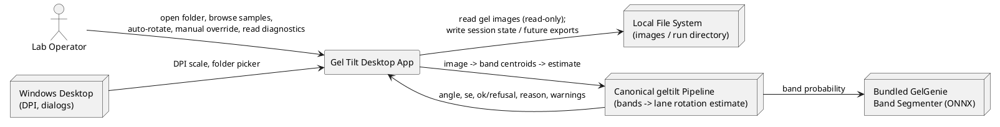
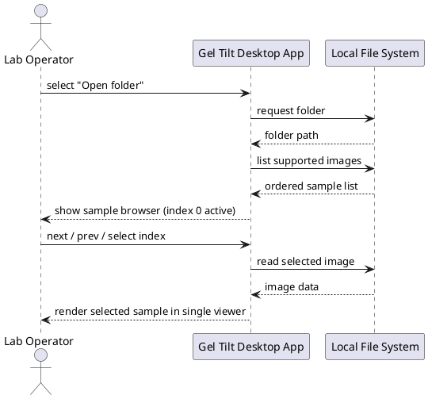
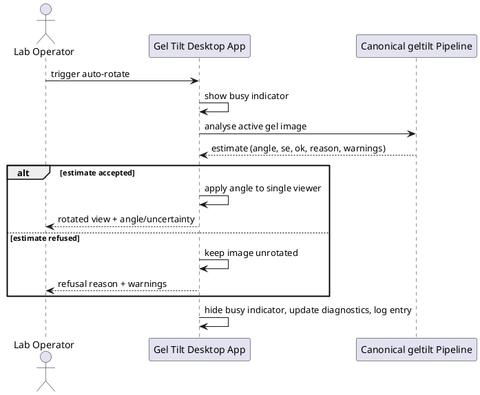
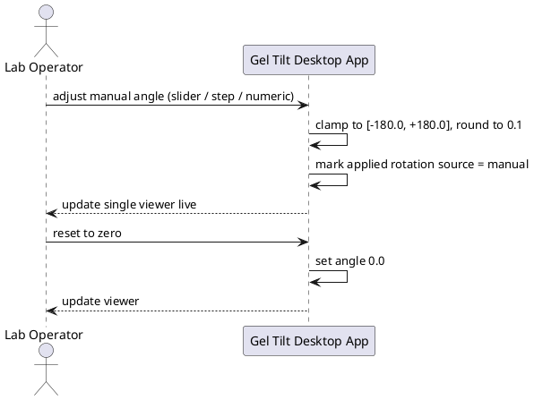
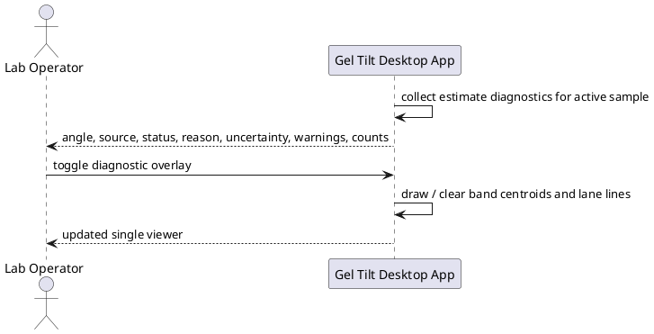
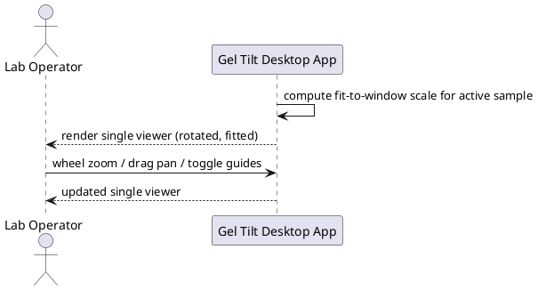
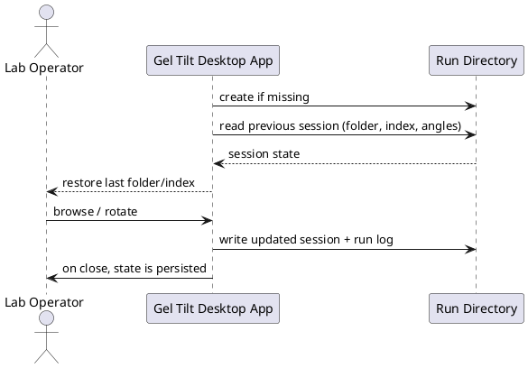

# Gel Tilt Desktop App — Requirements Specification

> Feature: `tkinter_frontend` · Status: Draft for review
> This document defines **what** the application must do, not how it is built.
> The subject of every requirement is **the App** (the Gel Tilt Desktop App).

---

# 1. Component Positioning

## 1.1 Core Responsibility
The App is a single-window Windows desktop application that loads folders of gel electrophoresis images, obtains the lane tilt from the canonical lane-based rotation engine, shows the estimate and its diagnostics, and applies automatic or manual rotation in one viewer.

## 1.2 Core Inputs
1. **User operation commands** (mouse/keyboard): open folder, select a sample by index, move to previous/next sample, trigger auto-rotate, edit the manual angle, reset the view, toggle diagnostic overlays.
2. **Launch parameters**: an optional initial folder path and an optional run-directory path supplied when the App is started.
3. **Gel image files on disk**: supported raster images found in the selected folder.
4. **Bundled GelGenie band-segmentation model**: consumed by the canonical pipeline to produce band centroids.
5. **Planned (not currently active) input**: lane-crop boundary interaction.

## 1.3 Core Outputs
1. **Rendered sample view** to the user: the active image at the applied rotation, shown in a single viewer, with an optional diagnostic overlay of detected band centroids and accepted lane lines.
2. **Diagnostic panel** to the user: estimate angle, uncertainty, accepted/refused status, reason, warnings, and band/lane counts.
3. **Session state persisted to the run directory**: current folder, current index, and the applied rotation (value and source) for each visited sample.
4. **Planned (deferred) outputs**: exported corrected images and lane crops written into the run directory. Not produced by the current version.

## 1.4 Responsibility Boundaries
The App is **not** responsible for the following, and shall not duplicate them:
1. **The rotation algorithm**: the App reuses the single canonical lane-based estimator. It shall not implement, embed, or fall back to a second rotation method.
2. **Band-segmentation model internals**: the App consumes band centroids from the canonical pipeline; it does not define the model.
3. **Lane-based cropping**: discussed and planned, but explicitly **not implemented** now.
4. **Exporting/saving processed image outputs**: discussed and planned, but explicitly **not implemented** now.
5. **Batch/command-line processing**: owned by the existing command-line interface.
6. **General image editing**: no drawing, annotation, masking, or non-rotation edits.
7. **Multi-viewer layouts**: exactly one viewer; no side-by-side or split comparison view.
8. **Legacy development tools**: the previous labelling and projection-viewer tools are development-only and are retired; the App shall not be modelled on them beyond reusing the canonical pipeline.

---

# 2. Domain Terminology

**Gel image**
: A raster image of an electrophoretic gel containing lanes and bands.

**Lane**
: A vertical column of bands produced by one sample or well; when the gel is tilted the lane leans away from vertical.

**Band**
: A localised region of signal within a lane, corresponding to a resolved fragment.

**Ladder**
: A lane carrying regularly spaced reference bands. For the rotation engine a ladder is structurally the same as any lane.
: Note: The engine intentionally does not privilege ladders over sample lanes.

**Band centroid**
: The sub-pixel `(x, y)` location of a detected band, in image pixels.

**Tilt**
: The angle by which the lanes deviate from vertical.

**Correction angle (rotation angle)**
: The number of degrees to rotate the image so that lanes become vertical. Positive is counter-clockwise on screen (y downward); the angle is applied as-is.
: Note: Applying the negated angle doubles the error; the App shall never negate it.

**Auto-rotation**
: The automatic estimation and application of the correction angle from the image alone.

**Manual override**
: A user-supplied correction angle that replaces the automatic estimate for the active sample.

**Estimate**
: The rotation engine's result for an image: the angle, its uncertainty, an accepted/refused status, and diagnostics.

**Refusal**
: The estimator declines to produce a usable angle (`ok = false`). The image is left unrotated and the reason is shown.

**Diagnostic information**
: The estimate angle, uncertainty, accepted/refused status, reason, warnings, band count, and lane counts.

**Sample**
: One gel image file within the loaded folder.

**Sample browser**
: The folder list plus the index-based navigation (previous/next/jump) over samples.

**Single viewer**
: Exactly one image display surface showing exactly one image at a time; no side-by-side layout.

**Run directory**
: The working directory the App writes its session state (and, later, exported outputs) into.

**DPI scaling**
: The window/layout scale factor equal to the display DPI divided by 96 (1.0 at 96 DPI, 2.0 at 192 DPI).

**Canonical pipeline**
: The existing in-repo processing chain — band segmentation → band centroids → lane-based rotation estimate — used unchanged by the App.

---

# 3. Roles and Boundaries

## 3.1 Core Roles
1. **Lab operator**: a person who opens a folder of gels, browses samples by index, triggers auto-rotation, reads the returned diagnostics, and manually overrides the angle when needed.

## 3.2 External Systems
1. **Windows desktop environment**: supplies per-monitor DPI scaling information and native folder/file dialogs.
2. **Local file system**: supplies source gel images (read-only) and the run directory (read/write for session state and future exports).
3. **Canonical geltilt pipeline**: provides band centroids and the lane-based rotation estimate for a given image.
4. **Bundled GelGenie ONNX band segmenter**: provides the band-probability map consumed by the canonical pipeline.
: Note: the App is fully offline; none of these interactions use a network.

## 3.3 Interaction Context

---

# 4. DFX Constraints

## 4.1 Performance
1. The App shall become interactive within **3 seconds** of launch on the reference machine.
2. One auto-rotation estimate of a **1280×1024** gel image shall complete within **30 seconds**, with a typical target of **≤10 seconds** on the reference CPU (single-instance, CPU-only).
3. The estimate shall be performed off the UI thread; the window shall not be blocked for more than **250 ms** at a time, and a busy indicator shall be shown while an estimate is running.
4. Applying a manual angle or navigating between samples shall re-render the single viewer within **500 ms** for a 1280×1024 image.

## 4.2 Reliability
1. The App shall not crash when the estimator refuses or when a sample fails to load; the session shall remain usable.
2. For an identical image and unchanged settings, the auto-rotation estimate shall be **deterministic** (identical angle across runs).
3. A failure on one sample shall be isolated to that sample and shall not corrupt the session state of other samples.
4. The App should restore the last folder, index, and applied rotation on the next launch.

## 4.3 Security
1. The App shall operate fully offline and shall not perform network access or send telemetry.
2. Source image files shall be opened **read-only**; the App shall never modify or overwrite a source image.
3. Only the run directory shall be written to; the App shall not write anywhere else without an explicit user action.
4. Diagnostic logging shall contain only metadata about the current sample, never raw image pixels exported outside the run directory.

## 4.4 Maintainability
1. Each auto-rotation run shall append a structured diagnostic log entry — timestamp, sample name, angle, uncertainty, accepted/refused status, reason, warnings — to a log file in the run directory.
2. For the same image, the angle, accepted/refused status, and reason shown by the App shall match the canonical command-line result.
3. Errors shall be surfaced to the user and logged; the App shall not silently swallow failures.

## 4.5 Compatibility
1. The App shall run on **Windows 10/11, 64-bit**, and shall be delivered as a **windowed (no console) PyInstaller executable**.
2. The App shall be **DPI-aware**: at 192 DPI (200% scaling) all window geometry, fonts, and interactive hit targets shall be scaled by **dpi/96** so that content renders crisply and controls remain reachable; at 96 DPI the scale factor shall be 1.0.
3. Supported input extensions: `.tif`, `.tiff`, `.png`, `.jpg`, `.jpeg`, `.bmp` (case-insensitive).
4. Supported input pixel formats: 8-bit and 16-bit integer and float, grayscale and color.
5. The App shall use the existing image loading and the canonical processing pipeline unchanged.

---

# 5. Core Capabilities

## 5.1 Folder and Sample Browsing

### 5.1.1 Business Rules
1. **Folder selection**: When the user selects a folder through the folder picker, the App shall list every supported image in that folder as a sample.
   a. Acceptance criteria: User picks a folder containing N supported images → the sample browser shows N entries.
2. **Ordered indexing**: The App shall order samples by ascending file name and assign a stable integer index starting at 0.
   a. Acceptance criteria: User opens a folder → sample at index 0 is active and the list is in ascending name order.
3. **Index navigation**: The App shall provide previous, next, and direct jump-to-index navigation.
   a. Acceptance criteria: User activates "next" on the last sample → the App stays on the last sample and does not wrap.
   b. Acceptance criteria: User selects entry k in the list → sample index k becomes active.
4. **Single active sample**: The App shall have exactly one active sample at any time and shall display its index and name.
   a. Acceptance criteria: Any navigation action → exactly one sample is shown as active.
5. **Supported-files filter**: The App shall ignore files whose extension is not supported.
   a. Acceptance criteria: A folder containing one `.txt` and one `.png` → only the `.png` is listed.
6. **Per-sample state retention**: The App shall retain each visited sample's applied rotation and estimate for the session and shall restore it when the user returns to that sample.
   a. Acceptance criteria: Rotate sample A, move to sample B, return to A → A still shows its applied rotation.
7. **Prohibition — source modification**: The App shall not modify, rename, move, or delete any source file.
   a. Acceptance criteria: After any browsing and rotation activity → source files are byte-identical.

### 5.1.2 Interaction Flow

### 5.1.3 Exception Scenarios
1. **Empty folder**
   a. Trigger condition: The selected folder contains no supported images.
   b. System behavior: The App keeps the previously loaded folder and selection unchanged.
   c. User perception: A warning stating no supported images were found and listing the supported extensions.
2. **Folder not readable**
   a. Trigger condition: The folder cannot be read (permission denied or missing).
   b. System behavior: The App aborts the load and keeps prior state.
   c. User perception: An error message naming the folder and the cause.
3. **Unreadable/corrupt image**
   a. Trigger condition: A listed image fails to load.
   b. System behavior: The App marks the sample as failed in the current session and remains usable.
   c. User perception: An error naming the file; navigation to other samples still works.
4. **Large folder**
   a. Trigger condition: The folder contains a very large number of samples (≥2000).
   b. System behavior: The App still lists and navigates without becoming unusable.
   c. User perception: The sample browser remains responsive.

## 5.2 Automatic Rotation Estimate

### 5.2.1 Business Rules
1. **Explicit trigger**: When the user triggers auto-rotate for the active sample, the App shall obtain band centroids through the canonical pipeline and the correction estimate through the single canonical lane-based engine.
   a. Acceptance criteria: User triggers auto-rotate → an estimate is produced and its angle is applied to the viewer when the estimate is accepted.
2. **Single rotation engine**: The App shall reuse the canonical estimator and shall not use any alternative rotation method.
   a. Acceptance criteria: For a given image, the App's auto-rotate result equals the canonical command-line result.
3. **Applying an accepted estimate**: When the estimate status is accepted and the angle is finite, the App shall apply that angle to the single viewer and record it as the sample's applied rotation with source = auto.
   a. Acceptance criteria: Accepted estimate of angle θ → the view is rotated by θ and the applied rotation shows source "auto" and value θ.
4. **Handling a refusal**: When the estimate status is refused or the angle is not finite, the App shall leave the image unrotated (or at its prior angle) and shall show the refusal reason.
   a. Acceptance criteria: Refused estimate → no rotation is applied and the reason is displayed.
5. **Uncertainty reporting**: When an estimate is accepted, the App shall display its uncertainty alongside the angle.
   a. Acceptance criteria: Accepted estimate → uncertainty is shown in the diagnostic panel.
6. **Sign convention**: The App shall apply the estimate angle as-is (positive = counter-clockwise, y downward) and shall never negate it.
   a. Acceptance criteria: Estimate of −2.7° → the image is rotated by −2.7°, not +2.7°.
7. **Determinism**: Repeating auto-rotate on the same image without changes shall produce the same angle.
   a. Acceptance criteria: Trigger auto-rotate twice in a row → identical angle both times.
8. **Replacement**: Re-triggering auto-rotate shall replace the sample's previous automatic estimate.
   a. Acceptance criteria: Auto-rotate twice → only the latest estimate is shown and applied.
9. **Prohibition — silent fallback**: The App shall not silently rotate by 0° or substitute another method when the estimator refuses.
   a. Acceptance criteria: Refusal → the UI explicitly shows the refusal and applies no rotation.

### 5.2.2 Interaction Flow

### 5.2.3 Exception Scenarios
1. **Estimator refusal**
   a. Trigger condition: The engine reports `ok = false` for the active sample.
   b. System behavior: No rotation is applied; the reason and warnings are recorded and displayed.
   c. User perception: A clear "not rotated" status with the refusal reason.
2. **Model unavailable**
   a. Trigger condition: The bundled band-segmentation model is missing or cannot be loaded.
   b. System behavior: The estimate is aborted; the session remains usable.
   c. User perception: An error stating the model could not be loaded.
3. **Unexpected estimator error**
   a. Trigger condition: The estimate raises an unexpected error.
   b. System behavior: The error is caught, logged, and isolated to the active sample.
   c. User perception: An error dialog; the user can continue browsing or retry.
4. **Long-running estimate**
   a. Trigger condition: The estimate exceeds the expected duration.
   b. System behavior: The UI stays responsive and shows the busy indicator until the estimate finishes.
   c. User perception: A visible progress/busy state; the window does not freeze.

## 5.3 Manual Rotation Override

### 5.3.1 Business Rules
1. **Direct angle entry**: The App shall let the user set a correction angle directly using a continuous control and step buttons, and shall apply it immediately to the single viewer.
   a. Acceptance criteria: User sets the angle to +3.0° → the view rotates by +3.0° immediately.
2. **Range and resolution**: The manual angle shall accept values from **−180.0° to +180.0°** at **0.1°** resolution.
   a. Acceptance criteria: User requests +200° → the value is clamped to +180.0°.
3. **Precedence over auto**: When the user sets a manual angle, it shall supersede the automatic estimate for that sample and mark the applied rotation source = manual.
   a. Acceptance criteria: After an auto estimate, user sets a manual angle → the applied rotation shows source "manual" with the user's value.
4. **Auto re-run replaces manual**: Re-triggering auto-rotate shall replace the manual angle with the new estimate and mark source = auto.
   a. Acceptance criteria: Manual angle set, then auto-rotate → applied rotation shows source "auto".
5. **Zero/reset**: The App shall let the user reset the angle to 0.0°.
   a. Acceptance criteria: User activates "zero" → applied rotation becomes 0.0°.
6. **Fine and coarse nudges**: The App shall provide at least ±0.1° and ±1°/±10° step adjustments.
   a. Acceptance criteria: User activates a nudge → the angle changes by exactly that step.
7. **Live preview**: Each change to the manual angle shall update the rendered view without requiring a separate confirm action.
   a. Acceptance criteria: User drags the angle control → the rendered image updates continuously.
8. **Prohibition — no disk write**: Manual override shall never alter the source image on disk.
   a. Acceptance criteria: After any manual override → the source file is unchanged.

### 5.3.2 Interaction Flow

### 5.3.3 Exception Scenarios
1. **Non-numeric angle input**
   a. Trigger condition: The user types a value that is not a number.
   b. System behavior: The input is rejected and the last valid angle is kept.
   c. User perception: The control reverts to the last valid value.
2. **Out-of-range angle**
   a. Trigger condition: The user supplies a value outside −180.0…+180.0.
   b. System behavior: The value is clamped to the nearest bound.
   c. User perception: The control shows the clamped value.
3. **Override during an estimate**
   a. Trigger condition: The user edits the angle while an estimate is running.
   b. System behavior: The most recent user action determines the final applied rotation; the estimate result shall not silently overwrite a manual edit made after it started.
   c. User perception: The angle reflects the user's latest intent.

## 5.4 Diagnostic Display

### 5.4.1 Business Rules
1. **Always-visible diagnostics**: For the active sample the App shall display the applied rotation with its source (none/auto/manual), the estimate status (accepted/refused/not-run), the reason, the uncertainty, and any warnings.
   a. Acceptance criteria: Any active sample → the diagnostic panel shows angle + source + status for that sample.
2. **Counts**: When an estimate exists, the App shall display the number of detected bands and the number of lanes used relative to the number detected.
   a. Acceptance criteria: Accepted estimate → band count and "lanes used / lanes found" are shown.
3. **Refusal detail**: When an estimate is refused, the App shall display the reason and all warnings.
   a. Acceptance criteria: Refused estimate → reason text and warnings are visible.
4. **Diagnostic overlay**: The App shall be able to overlay the detected band centroids and accepted lane lines on the single viewer, toggled by the user.
   a. Acceptance criteria: User enables the overlay → centroids and lane lines are drawn over the image; user disables it → overlay is removed.
5. **Current-sample correctness**: The App shall not present diagnostics belonging to a different sample as if they were current.
   a. Acceptance criteria: After navigating to another sample → the diagnostics shown belong to the newly active sample or show "not run".
6. **Legibility at high DPI**: Diagnostic text shall remain legible at 192 DPI (200% scaling).
   a. Acceptance criteria: At 200% scaling → diagnostic text renders at its scaled size without clipping.

### 5.4.2 Interaction Flow

### 5.4.3 Exception Scenarios
1. **No estimate yet**
   a. Trigger condition: The active sample has not been auto-rotated.
   b. System behavior: The App shows a neutral "not run" status and any manual rotation in effect.
   c. User perception: A clear "estimate not run" indication.
2. **Overlay with no detections**
   a. Trigger condition: The estimate produced no band centroids or no accepted lanes.
   b. System behavior: The overlay is empty and the panel explains that no bands/lanes were detected.
   c. User perception: An explanatory note instead of an empty-looking overlay.
3. **Many warnings**
   a. Trigger condition: The estimate returns a long warning list.
   b. System behavior: The warning area is scrollable.
   c. User perception: All warnings are reachable without overflowing the layout.

## 5.5 Unified Single-Viewer Rendering

### 5.5.1 Business Rules
1. **One viewer**: The App shall render exactly one image in exactly one viewer; no side-by-side or split layout shall exist.
   a. Acceptance criteria: At any time → only one image panel is present.
2. **Fit-to-window default**: On loading a sample the App shall fit the image to the viewer while preserving aspect ratio.
   a. Acceptance criteria: Load a sample → the whole image is visible and not distorted.
3. **Zoom and pan**: The App shall support wheel zoom and drag panning of the viewer.
   a. Acceptance criteria: Wheel scroll → view zooms about the pointer; drag → view pans.
4. **Rotation applied on display**: The rendered view shall reflect the currently applied rotation.
   a. Acceptance criteria: After auto or manual rotation → the viewer shows the rotated image.
5. **Optional vertical guides**: The App shall offer optional vertical guide lines overlaid on the viewer to judge lane verticality.
   a. Acceptance criteria: Guides enabled → evenly spaced vertical lines are drawn; disabled → removed.
6. **Aspect-preserving downscale for display**: The App shall scale the image for display without changing the underlying sample data.
   a. Acceptance criteria: A large image is displayed downscaled but the sample data is untouched.
7. **Prohibition — no second panel**: The App shall not add a second image surface for comparison.
   a. Acceptance criteria: No control or layout produces two simultaneous image panels.

### 5.5.2 Interaction Flow

### 5.5.3 Exception Scenarios
1. **Extreme aspect ratio**
   a. Trigger condition: The sample has an unusual width-to-height ratio.
   b. System behavior: The App fits the image without distortion and keeps it within the viewer.
   c. User perception: The image is fully visible and undistorted.
2. **Viewer not yet laid out**
   a. Trigger condition: A render is requested before the viewer has a usable size.
   b. System behavior: The App defers rendering until a valid size is available.
   c. User perception: No error; the image appears once the window is laid out.

## 5.6 Application Session and Run Directory

### 5.6.1 Business Rules
1. **Run directory**: The App shall use a run directory (default: the app's launch directory, or a user-supplied path) and shall create it if missing.
   a. Acceptance criteria: Launch with a run-directory path that does not exist → the directory is created before first write.
2. **Session persistence**: The App shall persist the last folder, last index, and per-sample applied rotation (value and source) into a session file in the run directory.
   a. Acceptance criteria: Close and relaunch → the last folder and index are restored.
3. **Future export destination**: When export is later implemented, the run directory shall be its destination. (Currently no export is produced.)
   a. Acceptance criteria: No output image files are written by the current version.
4. **Run log**: The App shall write the structured diagnostic log of each auto-rotation run into the run directory.
   a. Acceptance criteria: After auto-rotate → a log entry exists for that sample and run.
5. **Prohibition — no source writes**: The session and log files shall never be written into a way that overwrites a source image.
   a. Acceptance criteria: Run-directory writes never modify source images.

### 5.6.2 Interaction Flow

### 5.6.3 Exception Scenarios
1. **Run directory not writable**
   a. Trigger condition: The run directory cannot be written.
   b. System behavior: The App warns once and continues in memory without persistence.
   c. User perception: A warning that session state will not be saved.
2. **Corrupt session file**
   a. Trigger condition: The session file is unreadable or malformed.
   b. System behavior: The App starts a fresh session without failing.
   c. User perception: The App opens with no restored folder.

## 5.7 Planned Capabilities (Out of Scope — Not Implemented)

### 5.7.1 Lane-Based Cropping (Planned)
1. **Deferred scope**: Lane-based cropping — detecting lane boundaries on the straightened gel and producing per-lane crops — is planned but **not implemented** in this version.
   a. Acceptance criteria: No lane-cropping action is available; if a placeholder control is shown it is disabled and labelled "planned".
2. **Prohibition — no partial behaviour**: The App shall not perform or approximate lane cropping in this version.
   a. Acceptance criteria: No user action produces a lane crop.

### 5.7.2 Output Export (Planned)
1. **Deferred scope**: Exporting the corrected image and/or lane crops to the run directory is planned but **not implemented** in this version.
   a. Acceptance criteria: No export action is available; if a placeholder control is shown it is disabled and labelled "planned".
2. **Prohibition — no unsolicited files**: The App shall not write processed image outputs during normal browsing or rotation.
   a. Acceptance criteria: After browsing and rotating → no corrected/cropped image files appear in the run directory.

---

# 6. Data Constraints

## 6.1 Sample Image
1. **Name**: Non-empty file name; used to key per-sample state.
2. **Path**: A readable absolute path within the loaded folder.
3. **Extension**: One of `.tif`, `.tiff`, `.png`, `.jpg`, `.jpeg`, `.bmp` (case-insensitive).
4. **Index**: Integer ≥ 0; unique within the loaded folder; assigned by ascending name order.
5. **Dimensions**: At least 1×1 pixels; the reference case is 1280×1024 (width×height).
6. **Value format**: 8-bit or 16-bit integer, or floating point; grayscale or color.
7. **Modifiability**: The sample is read-only for the App; its on-disk bytes shall not change.

## 6.2 Rotation Estimate
1. **Angle**: A finite real number of degrees; convention positive = counter-clockwise (y downward); meaningful range −180.0…+180.0; applied only when the estimate is accepted.
2. **Uncertainty**: A non-negative real number of degrees; finite when the estimate is accepted.
3. **Status (`ok`)**: Boolean; true means the angle may be applied, false means refusal.
4. **Reason**: A non-empty text explanation; on refusal it states why no angle was given.
5. **Warnings**: A possibly empty list of text notes (e.g. weak lane, short lever arm, fallback used, lanes disagreeing).
6. **Band count**: Integer ≥ 0; the number of detected band centroids.
7. **Lanes used / found**: Integers with 0 ≤ used ≤ found; the accepted lanes versus detected lanes.
8. **Fallback flag**: Boolean; true when the estimate relied on a weak short-lane fallback.
9. **Band centroids**: Zero or more `(x, y)` points with finite values inside the image bounds.
10. **Lane lines**: Zero or more lanes, each characterised by its position (x-offset), shared lean (slope-equivalent), rung count, and its own angle and uncertainty.

## 6.3 Applied Rotation
1. **Value**: Real number of degrees in −180.0…+180.0, rounded to 0.1° resolution.
2. **Source**: Exactly one of `none`, `auto`, `manual`; `none` implies value 0.0.
3. **Validity**: When source is `auto`, the value must come from an accepted estimate; a refused estimate must not produce an `auto` applied rotation.

## 6.4 Session State
1. **Folder**: The last opened folder path, or empty when none has been opened.
2. **Index**: Integer within `[0, sample count − 1]`, or 0 when no folder is loaded.
3. **Applied rotations**: A mapping keyed by sample name → `{value, source}`.
4. **Updated timestamp**: The time the state was last saved.
5. **Round-trip integrity**: Reloading a saved session shall restore folder, index, and applied rotations without error.

## 6.5 Run Directory
1. **Path**: A writable directory; default is the app launch directory; user-supplied override permitted.
2. **Session file**: Exactly one session file per run directory.
3. **Run log**: A single append-only diagnostic log file in the run directory.
4. **Isolation**: Files written by the App shall be confined to the run directory and shall never overwrite a source image.